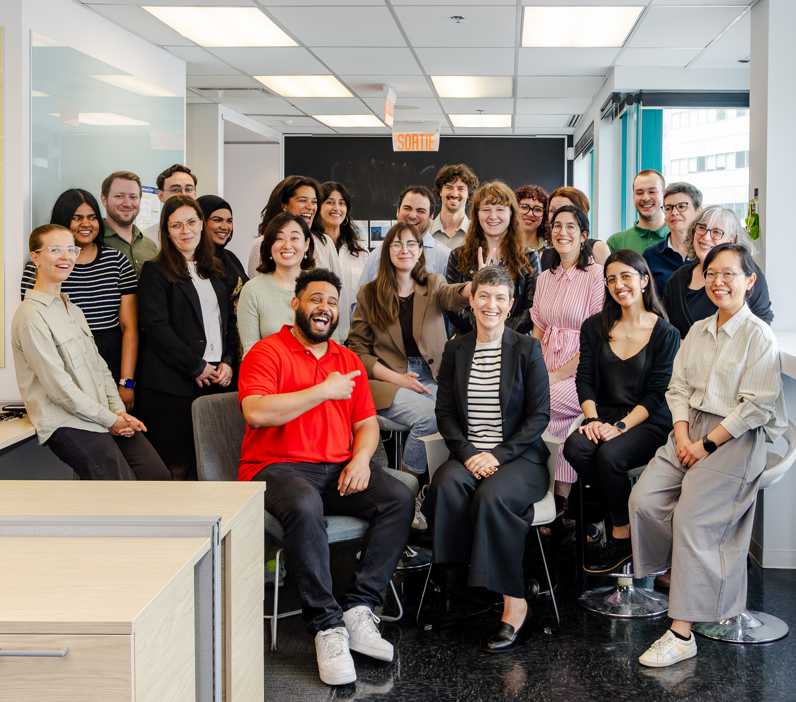

I work with governments, community organizations, research networks and the media to bring research evidence into public debates and decisions about immigration. 

## Areas of expertise

-   Immigration policy and politics in Canada and Quebec
-   Federalism and intergovernmental relations in immigration
-   Policies for residents without immigration status
-   Immigration public administration and bureaucracy
-   The impact of technologies on migration governance
-   Public opinion on immigration
-   Immigration promotion and the migration industry

## Current research leadership

**Director, [Institute for Research on Migration and Society (IRMS)](https://www.concordia.ca/artsci/research/irms.html)**, since 2024. IRMS is the hub for immigration research at Concordia University, with partners in Montreal, across Quebec and Canada, and internationally. It brings together 15 faculty members, postdoctoral researchers and research professionals working on topics such as migration pathways, the platform economy, and immigration and digital literacy.

**Co-lead, [Réseau québécois de la recherche en immigration, en intégration et en relations interculturelles (RQ3i)](https://rq3i.ca)**, since 2024. RQ3i is a network funded by the FRQSC and developed in collaboration with Quebec's ministère de l'Immigration, de la Francisation et de l'Intégration. It connects 39 co-researchers from 15 institutions, 25 government and non-governmental partner organizations across Quebec, and more than 150 student members. I oversee the network's scientific direction and governance, its relations with the Government of Quebec, and its forecasting activities.

**Concordia institutional lead, [Bridging Divides](https://www.torontomu.ca/bridging-divides/)**, since 2023. This Canada First Research Excellence Fund program studies migrant integration and advanced technologies, with a focus on citizenship and civic participation, the future of work, health care and the responsible use of artificial intelligence. I lead the program at Concordia, sit on its institutional board and co-direct one of its four thematic clusters.

Contact me to learn about my other research leadership experiences (and my future plans!).


{width="100%"}


## Policy advising and consulting

I advise and consult for public institutions and community organizations, and I take on research contracts. I have worked with Quebec's ministère de l'Immigration, de la Francisation et de l'Intégration, the Ville de Montréal, the Musée de la civilisation and the Maison de l'innovation sociale and several non-profits.

Contact me to learn more details about my past mandates and projects.


## Media

I am happy to speak with journalists about my research and about immigration and politics in Canada and Quebec, in French or in English. I was named Expert Commentator of the Year at Concordia University. I have contributed to local media and to outlets such as the [New York Times](https://www.nytimes.com/2017/08/10/world/americas/a-surge-of-migrants-crossing-into-quebec-tests-canadas-welcome.html) and [CBC's The Current](https://www.cbc.ca/radio/thecurrent/the-current-for-june-18-2019-1.5178745/quebec-s-new-immigration-law-could-be-attempt-to-win-more-powers-from-ottawa-expert-1.5178750), and I recently discussed Canada's immigration debate on the [IRPP's Futureproofing Canada podcast](https://irpp.org/podcast/canada-immigration-backlash).

Je suis disponible pour des entrevues, en français ou en anglais, sur mes recherches ainsi que sur l'immigration et la politique canadienne et québécoise.

```{=html}
<!-- PHOTO 3 (a media appearance or interview). Same steps as above.
{width="100%"}
-->
```

## Work with me

I am open to requests for consultation, expert reports, advisory committees, public talks and training sessions, in French or in English. Please write to mireille.paquet \[at\] concordia.ca.
